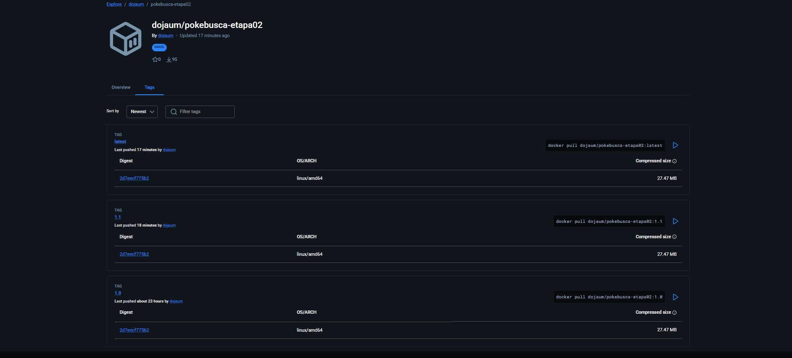
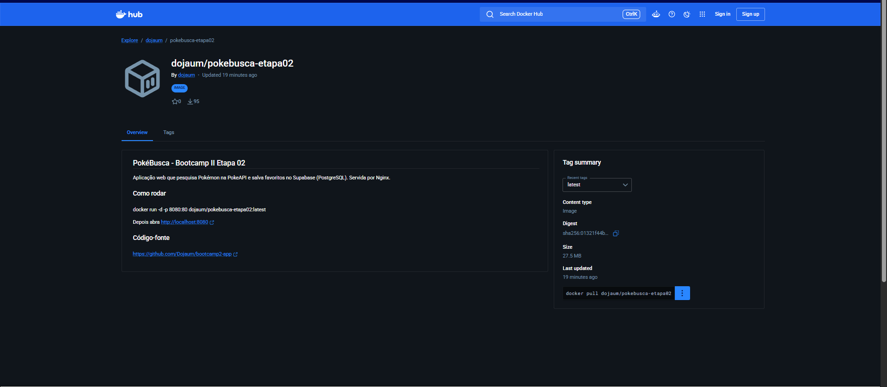
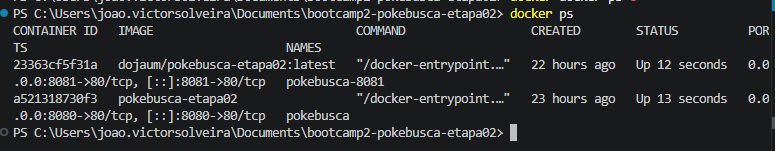
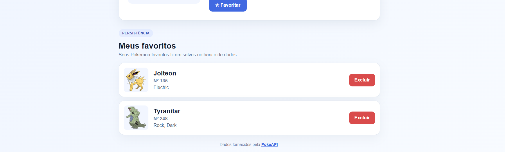
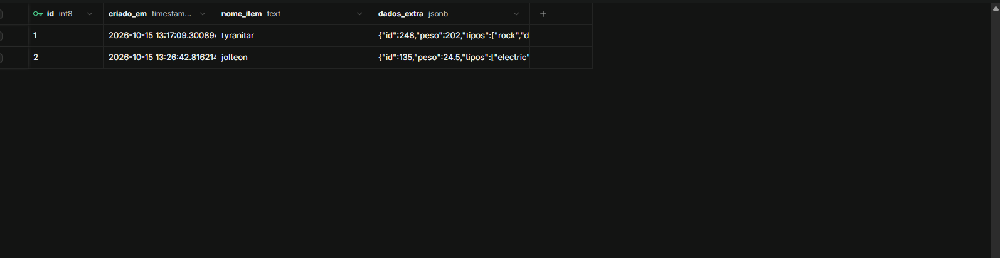

# PokéBusca - Bootcamp II (Etapa 02)

**Aluno:** João Victor Siqueira Oliveira
**Matrícula:** 22451816

## Links

- **Repositório GitHub:** https://github.com/Dojaum/bootcamp2-app
- **GitHub Pages:** https://dojaum.github.io/bootcamp2-app/
- **Docker Hub:** https://hub.docker.com/r/dojaum/pokebusca-etapa02

## Como executar com Docker

```
docker run -d -p 8080:80 --name pokebusca dojaum/pokebusca-etapa02:latest
```

Depois, acesse http://localhost:8080 no navegador.

## Persistência (Supabase)

- **Banco:** Supabase (PostgreSQL), projeto `pokebusca-etapa02`.
- **Tabela:** `favoritos`, com as colunas `id`, `criado_em`, `nome_item` e `dados_extra`.
- **O que é salvo:** os itens que o usuário marca como favoritos na página. Ao recarregar (F5), a lista é lida do banco e os favoritos continuam lá.
- **Script de criação:** `supabase.sql`.
- **Limitação do RLS aberto:** a tabela usa RLS (Row Level Security) com políticas públicas de `select`, `insert` e `delete`. Isso significa que qualquer pessoa com a chave "anon public" (que fica visível no `script.js`) pode ler, inserir e apagar favoritos. Não há login nem separação por usuário, então isso serve só para fins didáticos e não seria adequado em produção.
- **Teste realizado:** criar e listar favoritos foram testados e persistem após F5. O botão Excluir ainda não foi testado, por isso não afirmo seu funcionamento.

## Sidequests

### SQ1 - .dockerignore

O arquivo `.dockerignore` lista arquivos e pastas que não devem ser enviados ao Docker durante o build (por exemplo, a pasta `.git`). Isso deixa o build mais rápido e evita colocar na imagem arquivos que ela não precisa.

### SQ2 - Tags no Docker Hub

Foram publicadas as tags `1.0`, `1.1` e `latest`. A `1.1` e a `latest` apontam para a mesma imagem (digest `01321f44b9bed6e8...`); a `1.1` foi construída com a linha `LABEL description="PokeBusca Etapa 02 - Nginx com Supabase"` no Dockerfile.



### SQ3 - Overview do Docker Hub

O Overview do repositório no Docker Hub contém a descrição do projeto, o comando `docker run` e o link do GitHub.



### SQ4 - Dois containers e Kubernetes

Foram executados dois containers da mesma imagem, um na porta 8080 (`pokebusca`) e outro na porta 8081 (`pokebusca-8081`):

```
docker run -d -p 8080:80 --name pokebusca dojaum/pokebusca-etapa02:latest
docker run -d -p 8081:80 --name pokebusca-8081 dojaum/pokebusca-etapa02:latest
```



**E se fossem 100 containers?** Subir 100 containers à mão, cada um com sua porta, seria inviável: seria preciso iniciar, monitorar, reiniciar quando caem e distribuir o tráfego entre eles manualmente. É para isso que existe o Kubernetes, que gerencia containers automaticamente. Nele, um **cluster** é o conjunto de máquinas que executam as aplicações; um **pod** é a menor unidade, que agrupa um ou mais containers; e uma **réplica** é uma cópia idêntica de um pod. Ao pedir, por exemplo, 100 réplicas, o Kubernetes cria as cópias, recria as que falharem e distribui as requisições entre elas.

## Outras evidências




